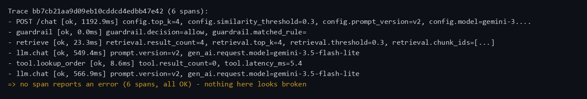
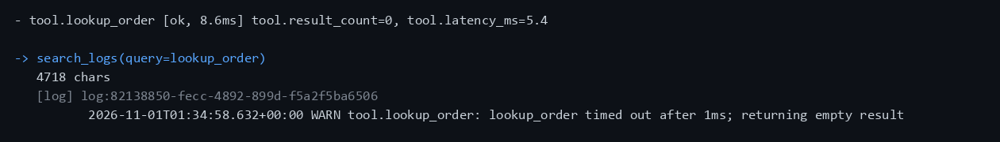
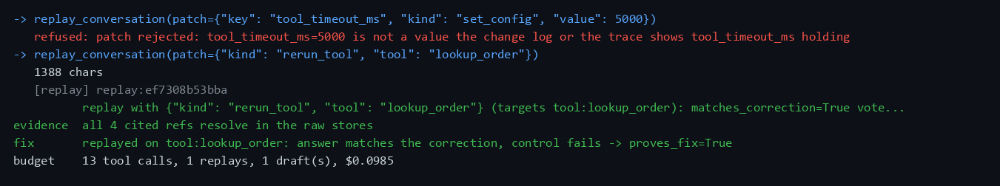

# Tracewise

An agent that figures out **why** an AI support assistant gave a wrong answer — and proves it.

When a support bot answers wrong, the usual verdict is "the model hallucinated." Usually that's
wrong: the model did its job with bad inputs — a stale document, a tool that timed out and returned
nothing, a retrieval miss. Tracewise traces the failure to the step that actually broke, **verifies
every piece of evidence it cites** against the real data, and **proves the fix by replaying the
conversation** with the suspected cause patched. When the evidence isn't there, it abstains instead
of guessing.

Faults are injected on purpose, so the true cause of each case is known. Every number below comes
from a **locked held-out split the prompt was never tuned on**.

## Results

23 held-out failures. One run.

| method | top-1 | hallucinated evidence | fix proven by replay | $/case |
|---|---|---|---|---|
| **Tracewise** | **52%** | **0%** | **83%** | $0.078 |
| same model, no tools | 43% | 0% | 0% | $0.005 |
| blame the error span | 0% | 0% | 0% | — |

"Blame the error span" scores 0% because these faults *leave no error span* — a swallowed timeout
is an OK span, a stale document retrieves fine. The no-tools baseline is the real one, and it's
strong: the same model, handed the transcript and the change list, gets 43%. Tracewise's edge isn't
answering more — it answers *less*. It's that **when it answers, it's right 12 out of 12**, cites
nothing it can't support, and proves 83% of its fixes by replay. The baseline's 43% comes with no
way to tell which 43% to trust.

It abstains on about half the cases rather than guess — every abstention ran out of tool-call budget
holding the right idea but one signal short. That's a budget limit, not a reasoning one, and it was
left un-tuned on purpose: the split was opened once, and tuning on it would make the number dishonest.

## See one investigation

One real, held-out run. The bot says a customer has no orders; the order exists and is inside the
return window, so the answer should be yes.

**Nothing looks broken — every span reports OK.** The error-span heuristic has nothing to go on,
and the no-tools baseline blamed the model. But look at `tool.lookup_order`: status `ok`, and
`result_count=0`.



**Tracewise goes upstream and finds two independent signals** at the same component: the lookup
returned 0 results, and the logs show it timed out after 1ms and returned empty.



**Then it proves the cause.** Its first replay patch is *refused* for citing a value the history
never showed — the anti-cheating rule working in real time — and it recovers with a legitimate
patch that re-runs the tool. The answer comes back correct while an unpatched control still fails,
so the replay proves the fix rather than coinciding with it.



It also **ruled out the decoy**: an unrelated document change sitting in the log shortly before the
failure, dismissed as *"published a month prior and correctly retrieved"* rather than blamed for
the coincidence.

Diagnosis: `tool:lookup_order`, timeout misconfigured — the same case the no-tools baseline called
a model hallucination.

*Unedited; the raw terminal output is in [`docs/demo-case-023.txt`](docs/demo-case-023.txt), and
every line above is from that one run. Full run as a GIF (18s):*

<details>
<summary>watch the whole investigation</summary>


</details>

## What makes the result trustworthy

- **The agent can't see the answers.** No "correct version" flag anywhere it can read; ground truth
  lives only in the evaluator. It reasons from dates, diffs and evidence like a real on-call engineer.
- **Decoys.** The change feed mixes real changes with innocent ones, unlabelled. It has to not blame
  the coincidence.
- **Replay can't cheat.** Each replay applies one patch whose target component is fixed in code — it
  can't "fix" the answer by changing something unrelated and taking credit.
- **A code gate, not the model, decides.** A diagnosis is accepted only with two independent pieces
  of evidence, or one plus a proven replay — which is what holds hallucinated evidence at 0%.

## Known limits

Synthetic assistant, one domain, faults injected one at a time. Small benchmark (23 scored cases, so
one case moves top-1 ~4 points). Abstains on half — useful precision, limited coverage. Stated
plainly because the project is built to find out whether the agent is good, not to look good.

## How it's built

```text
support assistant (every step an OpenTelemetry span)
   | traces / logs / metrics          fault injector --> change log (+ decoys)
   v
MCP tool server (10 tools, typed refs the verifier can re-check)
   v
LangGraph investigator: triage -> hypothesize -> investigate -> verify (code) -> conclude | abstain
   v
evaluator: evidence verifier + replay checker + scorer   (ground truth lives here only)
```

**Python · LangGraph · Claude / Gemini · MCP · OpenTelemetry · Jaeger · OpenSearch · Postgres +
pgvector · Prometheus · Docker Compose**

Each piece earns its place. The support assistant is a **FastAPI** app that answers from policy
documents stored in **Postgres with pgvector** — one database holding the document versions, the
store data the tools read, and the change log, so "which version was indexed when" is a query
rather than a guess. Every step it takes emits an **OpenTelemetry** span, which is what makes the
failure traceable at all: the trace goes to **Jaeger**, its log lines to **OpenSearch** (full-text,
so the agent can search for "timed out"), and answer accuracy to **Prometheus**, where a quality
drop becomes an alert. The investigator itself is a **LangGraph** state machine — the stages are
explicit, the verification gate is a real node, and the tool-call budget is enforceable. It reaches
the data only through an **MCP** server, so the tools are testable on their own and return typed
refs the verifier can re-check. The model (**Gemini** by default, **Claude** supported) does the
reasoning; the gate, the verifier and the scorer are plain Python, deliberately, because the thing
checking the model's work shouldn't be the model. **Docker Compose** runs all six services on one
machine.

Once the stack is up and seeded ([setup](ARCHITECTURE.md#run-it)), you can watch an investigation
run against a recorded case:

```bash
python -m eval.replay_case --cases case-023 --verbose
```

*Full build & component reference in [`ARCHITECTURE.md`](ARCHITECTURE.md); design decisions in
[`DECISIONS.md`](DECISIONS.md).*
