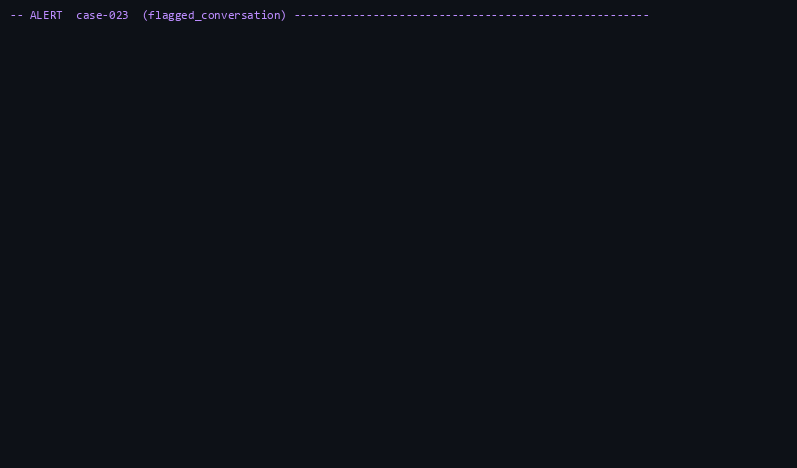

# Tracewise

An agent that investigates why an AI support assistant gave a wrong answer. It pulls the conversation's trace,
checks what was retrieved, what the tools returned and what changed recently, then **proves** its diagnosis by
replaying the conversation with the suspected cause patched. Every ref it cites is checked against the real data
stores, so a diagnosis that cites something that is not there is scored as wrong. When the evidence is not there,
it abstains instead of guessing.

It is graded, not demoed: faults are injected on purpose into a working assistant, so the true root cause of each
case is known, and all numbers below come from a **locked held-out split** the prompt was never tuned on.

## Results

28 held-out cases, `gemini-3.8-flash`, one run (`eval/results/test_runs.log`). 23 of the 28 are cases where the
injected fault was confirmed to have made the answer wrong; the table scores those.

| method | n | top-1 | top-3 | category | hallucinated evidence | fix success (replay) | abstained | $/case | s/case |
|---|---|---|---|---|---|---|---|---|---|
| **investigator** | 23 | **52%** | **96%** | 52% | **0%** | **83%** | 48% | $0.078 | 65 |
| B2: same model, no tools | 23 | 43% | 43% | 30% | 0% | 0% | 0% | $0.005 | — |
| B1: blame the ERROR span | 23 | 0% | 0% | 0% | 0% | 0% | 0% | — | — |

- **top-1 / top-3** — the true root component ranked first / in the top three. B1 and B2 produce a single answer,
  so their top-3 is their top-1.
- **hallucinated evidence** — diagnoses citing a span, chunk, log line or version that does not exist or does not
  match, checked by `eval/verifier.py` against the raw stores. These score as **wrong** even when the component is
  right. Zero across all three methods.
- **fix success** — the diagnosis's own suggested patch, replayed fresh, produces the correct answer *and* targets
  the true root component. B1 and B2 suggest no patch, so they cannot score here.
- **abstained** — refused to name a component for lack of evidence. Abstentions count as no answer in top-1.

**What the numbers say.** B1 scores 0%: almost none of these faults leave an error span, which is the whole point —
a swallowed tool timeout is an OK span and a stale document retrieves fine. B2 is the baseline that matters, and it
is a strong one: the same model, handed the transcript, the retrieved chunk text and the change list, gets 43%. The
investigator's advantage is not that it answers more often — it answers *less* often — but that **when it answers
it is right 12 out of 12**, cites nothing it cannot support, and proves 83% of its fixes by replay. B2 cannot
distinguish a confident guess from a supported one, and its 43% comes with no way to tell which 43%.

**The honest weakness: it abstains on half the cases.** Every abstention — all 14 across the 28 recorded cases,
11 of them in the scored 23 — hit the 15-tool-call ceiling, and on 8 of those 11 its top candidate was the correct
component. It had the right idea and ran out of budget before finding a second independent signal, so the binding
constraint is the step budget, not the reasoning or the verification gate. Raising the budget is the obvious next experiment, and deliberately *not* run here: the split
has been opened once and tuning against what it showed would turn a held-out result into a dev result.

Decoy resistance is reported in `eval/results/investigator-test-r1/comparison.md` but is not meaningful at this
sample size — 19 of the 23 cases carry a decoy, so the no-decoy baseline is 4 cases and the ratio swings wildly
(B2 scores *above* 100%, i.e. better with a decoy than without, which is noise, not robustness).

Full tables: `eval/results/investigator-test-r1/` (`summary.md`, `comparison.md`, per-case JSON with transcripts,
tokens, cost and wall time).

## See one investigation



*One held-out case, unedited: the assistant denies a customer's order exists. Every one of the six spans reports
OK — so "blame the error span" has nothing to go on, and the no-tools baseline blamed the model. Tracewise finds
the `lookup_order` span that returned 0 results, confirms the swallowed timeout in the logs, has one replay patch
refused for citing a value the history never showed, then proves the cause with a patch that does: re-running the
tool returns the order and the answer matches the reviewer's correction.*

*Recorded from `python -m eval.replay_case --cases case-023 --verbose`; the raw terminal output it was rendered
from is in [`docs/demo-case-023.txt`](docs/demo-case-023.txt). This is one real run, kept as it came out:
the agent is not deterministic, and on this run it did not write a `ruled_out` entry for the unrelated document
update, though it did on the run the results table comes from (see the written example below).*

## A worked example

**case-023**, held out, a silent tool failure with a decoy. B2 blamed the model on this case. This walks through
the run the results table above comes from, recorded in `eval/results/investigator-test-r1/case-023.json` — the
same case as the GIF, a different run of it.

The customer asks: *"I'm customer C-0003. Today is 2026-10-12. Can I still return the Cirrus Down Jacket from
order O-1003 for a refund?"*

The assistant answers: *"I couldn't find any orders associated with customer ID C-0003, so I am unable to verify
the delivery date... Answer: No"* — and the reviewer corrects it: order O-1003 was delivered 2 days ago, inside
the 14-day window, so the answer is yes.

Nothing in the trace is marked as an error. The `lookup_order` span has status OK; it simply returned nothing.

The investigation, 14 tool calls in 52 seconds for $0.11:

1. `search_logs` on the tool component, then `recent_changes`, then `get_trace` — it goes upstream rather than
   blaming the model for the wrong answer.
2. It finds the tool span **returned 0 results while taking 5.4 ms**, and a log line saying `lookup_order timed out
   after 1ms and returned an empty result`. That is two independent evidence types (a span and a log) pointing at
   the same component.
3. `replay_conversation` re-runs the conversation with one patch — re-run `lookup_order` — and the answer comes
   back with order O-1003 found, matching the reviewer's correction. The unpatched control run still fails, so the
   replay *proves* the fix rather than coinciding with it.

Its diagnosis: `tool:lookup_order` / `tool_outage`, confidence 0.99 — *"the lookup_order tool timed out because the
configured timeout was set to 1ms, resulting in empty order lookup results."*

**And it ruled out the decoy.** A document update (`change:doc-update-1047`) sits in the change log shortly before
the failure, looking guilty. The agent dismissed it: *"doc updates occurred weeks prior and holiday-returns is not
the source of the empty order lookup result."*

The evidence verifier then re-checked all three cited refs against the raw snapshot and replay log, and the fix
patch was replayed once more from scratch: `matches_correction: true`, `proves_fix: true`, target
`tool:lookup_order`. Diagnosis accepted.


## How the benchmark works

A fault is injected into a healthy assistant, the failing conversation is recorded, and the fault is reverted. The
recorded snapshot — trace, logs, chunks, config, change log, store data — is what the investigator is run against
later, so results reproduce without re-injecting.

### The anti-cheating rule

The investigator cannot see the fault injector, its labels, or anything marking a version as the correct one. In
real life there is no file telling you what broke. Concretely:

- `document_history` returns every version with timestamps and indexed-chunk counts, and **no "current" flag**. The
  agent reasons from dates and the change log.
- `recent_changes` returns real changes **and decoys in the same format**, unlabelled. A decoy is a genuine but
  innocent change written shortly before the failure: a typo fix in the prompt, an unrelated document published, a
  config change to an unrelated setting.
- `replay_conversation` applies only patches built from what the agent can legitimately see — a document version
  from history, a prompt version, a config value present in the change log or on the trace. **The component a patch
  targets is fixed by the patch kind in code, never chosen by the agent**, so a replay cannot "fix" the answer by
  changing something unrelated and taking credit for it.
- Ground truth lives only in the evaluator: the `eval` schema, which the `tools` role the MCP server connects as
  cannot read.

### Two signals, or one plus a proven fix

`agent/verify.py` is plain code, not a model call. It accepts a diagnosis only when every cited ref came from a
tool during that investigation, and the evidence *relevant to the named component* covers two distinct types, or
one type plus a replay that fixed the answer by patching that component. Retrieved playbooks and past incidents
never count as evidence, only as hints. This is what keeps hallucinated evidence at 0% and precision at 100%, and
it is also what drives the 48% abstention rate — the two are the same mechanism.

### Splits

`train` (17 cases) is for tuning prompts. `dev` (5) was read during development and is never reported as held out.
`test` (28 locked) contains **every** case of two fault types the prompt never met during tuning — `embedding_mismatch`
and `guardrail_misfire` — so it measures generalization rather than recognition.

Two locks guard it. `eval/test_split.lock` pins the case ids and a hash of their JSON. `eval/frozen_prompt.sha`
pins the prompt **and the configuration that decides how it is used** (model, tool and replay budgets, escalation
threshold, output cap), because retuning a step budget changes the agent as much as a prompt edit would. A test run
refuses to start unless both still match, and names what moved if they do not. `eval/results/test_runs.log` records
every test-split run — the honest count of how many times the split has been looked at.

## Known limits

Stated plainly, because they bound what the numbers mean.

- **The assistant is synthetic.** Kestrel Outfitters is a fictional store with ~48 short policy documents and three
  store tools. Realistic in shape, not in scale or messiness.
- **The faults are injected, one at a time.** Real incidents arrive tangled, partially observed, and sometimes
  several at once. Every case here has exactly one true cause.
- **One domain, one architecture.** Retrieval plus tool calls plus a prompt. Nothing here shows the agent
  generalizing to a different system.
- **The benchmark is small.** 23 scored held-out cases means one case moves top-1 by about 4 points. Treat small
  gaps between methods as noise, and the decoy split as uninformative.
- **It abstains on half the held-out cases**, all of them at the tool-call ceiling. Useful precision, limited
  coverage.
- **Two fault types produce no cases.** `context_overflow` (a larger `top_k` only ever added recall) and
  `model_downgrade` (no available smaller model failed silently) keep their implementations and tests but could not
  be made to break an answer repeatably. A fault that cannot make an answer wrong is not a test case.
- **`search_playbooks` and `similar_incidents` are stubs.** Playbook and incident-memory retrieval, and the
  retrieval-lift experiment, are not built; the verifier already refuses to count them as evidence.
- **The assistant's model is not deterministic**, even at temperature 0, so each replay takes three samples and the
  majority counts, and every patched replay is compared against an unpatched control.

## Reproducing the results

```bash
python -m eval.b2 --split test                 # baseline B2 over the locked split
python -m eval.baselines b1                    # baseline B1 over the recordings
python -m eval.replay_case --agent investigator --split test   # refuses unless both locks match
python -m eval.score --compare \
    investigator=eval/results/investigator-test-r1/diagnoses.jsonl \
    b1=eval/diagnoses/b1_test.jsonl \
    b2=eval/diagnoses/b2_test.jsonl --split test
```

## How it is built

```text
   Kestrel support assistant (FastAPI): guardrail -> retrieve (pgvector) -> llm.chat -> tool.* -> llm.chat
     every step an OpenTelemetry span
        |                    |                 |
     traces               logs             metrics            Fault injector ---> change log
        v                    v                 v                                  (+ decoys)
     Jaeger            OpenSearch         Prometheus
        \__________________ | _________________/
                            v
              MCP tool server (10 tools, compact output, typed refs)
                            v
        LangGraph investigator: triage -> hypothesize -> investigate
                            -> draft -> verify (code) -> conclude | abstain
                            v
     Evaluator: evidence verifier + replay checker + scorer   (ground truth lives here only)
```

Python - LangGraph - Gemini / Claude - MCP - OpenTelemetry - Jaeger - OpenSearch - Postgres + pgvector - Prometheus - Docker Compose


## Run it

```bash
cp .env.example .env            # set ANTHROPIC_API_KEY
docker compose up -d            # postgres, jaeger, otel-collector, opensearch, prometheus, pushgateway

python -m venv .venv && .venv/Scripts/activate   # or source .venv/bin/activate
pip install -r requirements.txt

python -m eval.render_docs      # facts.yaml + doc_templates/ -> assistant/docs/
python -m assistant.bootstrap   # schema, config, prompts, store data, ingest docs
uvicorn assistant.app:app --port 8000
```

```bash
curl -X POST localhost:8000/chat -H 'content-type: application/json' \
  -d '{"conversation_id":"c-001","question":"How long do I have to return boots?"}'
```

The response includes `trace_id`. Open http://localhost:16686, pick service `kestrel-assistant`, and paste the ID into the search box.

## Canary

```bash
python -m eval.make_canary      # rebuild assistant/canary.json from facts.yaml + store seed
python -m eval.canary           # all 60 questions; pushes kestrel_canary_* to Pushgateway
python -m eval.canary --smoke   # the 14-question subset
```

Accuracy is queryable in Prometheus (http://localhost:9092) as `kestrel_canary_accuracy`, with a `category` label for `docs`, `tools` and `multistep`.

Runtime config lives in the `app_config` table and is read on every request. `python -m assistant.bootstrap --reset-config` restores the defaults.

## Fault injection and evaluation

```bash
python -m eval.setup_eval          # `eval` schema + `eval` / `tools` roles (ground truth is unreadable by `tools`)
python -m injector.make_cases      # 52 cases -> injector/cases/*.json and eval.cases
python -m eval.run_case case-001   # reset, inject, record, snapshot to eval/runs/case-001/, revert, check recovery
python -m eval.run_case --all
python -m eval.baselines b1        # rule-based baseline over the recorded traces
python -m eval.score eval/diagnoses/b1.jsonl   # -> eval/results/b1.md, b1.csv, b1_cases.csv
```

Fault types are in `injector/faults.py`, decoys in `injector/decoys.py`. Each fault has `apply()`, an idempotent
`revert()`, a `change_record()` (or `None` for an outage) and a `ground_truth()`. Real changes and decoys are
written to the `changes` table in the same format.

Eleven fault types, nine of which produce cases:

| Fault | Component / category | Cases |
|---|---|---|
| `stale_document` | `knowledge_base` / `doc_update` | yes |
| `missing_document` | `knowledge_base` / `doc_delete` | yes |
| `threshold_too_strict` | `retriever` / `config_change` | yes |
| `context_overflow` | `retriever` / `config_change` | none: a bigger `top_k` only ever added recall |
| `silent_tool_failure` | `tool:lookup_order` / `tool_outage` | yes |
| `stale_tool_data` | `tool:check_inventory` / `stale_data` | yes |
| `prompt_regression` | `prompt` / `prompt_edit` | yes |
| `chunking_regression` | `retriever` / `retrieval_failure` | yes (sizes 40-80, per doc) |
| `embedding_mismatch` | `retriever` / `retrieval_failure` | yes, **held out** |
| `model_downgrade` | `model` / `model_change` | none: no available smaller model fails silently |
| `guardrail_misfire` | `guardrail` / `guardrail_error` | yes, **held out** |

The two "none" rows keep their class and their apply/revert tests; a fault that cannot make an answer wrong
repeatably is not a valid case. The probes behind both calls are in `eval/probes/`.

### Alert types

`flagged_conversation` is one reviewer-flagged answer. `quality_drop` is a metric that fell: `run_case` runs the
full 60-question canary while healthy and again under the fault, and the alert carries `metric`, `before`, `after`
and up to 5 `failing_samples` (traces for up to 10 of them are snapshotted). A quality drop is confirmed in replay
only when one patch fixes at least **2 of 3** sampled failing questions — one lucky fix is not evidence of a broad
cause (`replay.run_quality_replay`).

### Split and lock commands

See [Splits](#splits) above for what the splits are and why they are locked.

```bash
python -m eval.splits --show            # split sizes, test ids, hashes, test-run count
python -m eval.splits --write-lock      # pin the test split (once)
python -m eval.splits --check           # verify the lock against the cases on disk
python -m eval.splits --freeze-prompt   # pin the prompt + config after tuning on train
python -m eval.replay_case --split train
python -m eval.replay_case --split test # refuses unless both locks still match
```

## Investigator tools (MCP)

Ten tools behind one MCP server (stdio). Eight work; `search_playbooks` and `similar_incidents` (Day 10) are
stubs with their real signatures.

```bash
python -m tools.server                                   # live stack (Jaeger, OpenSearch, Postgres as `tools`, Prometheus)
TRACEWISE_BACKEND=snapshot:case-007 python -m tools.server   # a recording from eval/runs/case-007/
TRACEWISE_BACKEND=snapshot:case-007 TRACEWISE_REPLAY=1 python -m tools.server   # with replay (~30 s to start)
npx @modelcontextprotocol/inspector .venv/Scripts/python.exe -m tools.server
```

| Tool | Returns |
|---|---|
| `get_trace(conversation_id)` | span tree: ref, parent, duration, status, key attributes |
| `get_retrieved_chunks(span_ref)` | ref, doc, version, score, text (300 chars) per chunk |
| `document_history(doc_id)` | every version, indexed chunk count, short diff; no "current" flag |
| `search_logs(component, query, start, end, limit)` | log lines + `total_matches` |
| `recent_changes(start, end)` | prompt, doc and config changes, decoys included |
| `diff_prompt_versions(a, b)` | unified diff, 80 lines max |
| `query_metrics(metric, start, end)` | min/max/mean and up to 10 sample points per series |
| `replay_conversation(conversation_id, patch)` | the answer with one patch applied, `matches_correction`, `proves_fix` |

Every fact carries a typed ref (`tools/refs.py`): `span:<trace>/<span>`, `chunk:<doc>@<v>#<n>`, `doc:<doc>@<v>`,
`log:<id>`, `change:<id>`, `prompt:<v>`, `metric:<name>@<ts>`, `replay:<id>`. `resolve_ref(backend, ref)` looks
one up. Responses stay under about 4,000 tokens, lists carry a `total`, and errors come back
as `{"error", "hint"}`.

Tests (`pytest tests/tools`) run every tool against each recording in `tests/fixtures/` and, if the stack is up,
against the live backend. Fixtures are copies of `eval/runs/<case>/`; regenerate one with
`python -m eval.run_case --force <case>`.

## Replay

`tools/replay.py` re-runs the assistant's own chat loop (`assistant.pipeline.answer`) on a recording with exactly one
patch, in memory: retrieval over the snapshot's chunks (re-embedded), its prompt versions and config, and the tool
responses recorded for the alert's trace. A patched tool is re-run against `store.json` instead.

| Patch | Targets (set by code, never by the caller) |
|---|---|
| `{"kind": "use_doc_version", "doc_id", "version"}`, `{"kind": "restore_doc", "doc_id"}` | `knowledge_base` |
| `{"kind": "set_config", "key", "value"}` | `retriever` (top_k, threshold, embedding model, chunk_size), `model`, `guardrail`, else `config` |
| `{"kind": "set_prompt_version", "version"}` | `prompt` |
| `{"kind": "rerun_tool", "tool"}`, `{"kind": "bypass_cache", "tool": "check_inventory"}` | `tool:<tool>` |

Versions must exist in the snapshot, and a `set_config` value must appear in the change log or on the trace.
`chunk_size` is patchable because a re-chunked doc keeps both chunkings in the table at once, distinguished by a
chunk-ref suffix (`chunk:refund-policy@v2#3/c80`); switching it moves index flags rather than re-chunking anything. The
assistant model is not deterministic at temperature 0, so each replay takes 3 samples and the majority counts, and
every patched replay is compared with an unpatched control: `proves_fix` is true only when the patch fixes the answer
and the control does not. The answer is checked against the alert's `answer_check` patterns in code, with an LLM
judge only when the answer contains both the right and the wrong fact. Every replay goes to a JSONL replay log.

```bash
python -m eval.backfill_snapshots       # add store.json + answer_check to cases recorded before Day 6
python -m eval.replay_determinism       # empty-patch replay of every case vs. its recording
```

## Investigator (LangGraph)

```text
triage ──► hypothesize ──► investigate ⟲ ──► draft ──► verify ─┬─► conclude
               ▲                                              ├─► hypothesize   (rejected, budget left)
               └──────────────────────────────────────────────┘
                                                              └─► abstain       (rejected, budget gone)
```

`agent/` holds the graph. **triage** calls `get_trace` and `recent_changes` (7 days) and summarizes them in code.
**hypothesize** asks the model for 3 to 5 ranked candidates. **investigate** is a tool-use loop, one model turn
per visit, and stops when the model has no more calls or the budget (15 tool calls, 3 replays, enforced in
`Toolbox.call_tool`) is used up. **draft** writes the spec 9.3 diagnosis, validated with Pydantic. **verify**
(`agent/verify.py`, plain code) accepts it only if every cited ref came from a tool and the evidence relevant to
the named component covers 2 types, or 1 type plus a replay that proved the fix by patching that component. A
rejection goes back to hypothesize with the reason, up to 3 drafts; then **abstain** records the top candidates and
what was missing. Tool results become typed evidence items in code, so every cited ref was copied from a tool.

The model is `INVESTIGATOR_MODEL` (default `gemini-3.8-flash`; `claude-*` models use the Anthropic SDK), temperature 0.

```bash
python -m eval.replay_case --agent investigator --cases all     # every case in eval/runs/, on its snapshot
python -m eval.replay_case --cases case-023 --verbose           # watch one investigation step by step
python -m eval.replay_case --cases case-002 case-007 --run-id try
```

`--verbose` (`agent/trace_view.py`) prints each step as it happens — the node entered, each tool call with the
arguments the agent chose, the typed evidence built from each reply, and the gate's verdict. It reads the state the
graph already streams and never writes back, so a run watched this way reaches the same diagnosis as one that is
not; an observer that raises is swallowed rather than failing the investigation. It forces one case at a time,
since two investigations printing at once interleave.

After each investigation the evaluator runs the evidence verifier (`eval/verifier.py`), which reads the raw
snapshot files and replay log, never the tools: an invented ref, a quote not in the text, a wrong attribute value
or a failed replay cited as a success marks the diagnosis hallucinated, and it scores as wrong. Then it applies the
diagnosis's `fix_patch` in a fresh replay: fix success means the answer matches and the patch targets the true root
component.

Each run writes `eval/results/<run_id>/`: one JSON per case (diagnosis, gate result, verification, fix replay,
transcript, tokens, cost, wall time), the replay logs in `replays/`, `diagnoses.jsonl`, and `summary.md` with the
investigator, the Day 5 run and B1 side by side. `--rescore --run-id <id>` rebuilds the summary without model calls.

## Tests

```bash
pytest     # needs the stack up and `python -m assistant.bootstrap` done
```

## Trace shape

| Span | Key attributes |
|---|---|
| `POST /chat` (root, FastAPI) | `kestrel.conversation_id`, `kestrel.config.*` |
| `guardrail` | `kestrel.guardrail.decision`, `.matched_rule` |
| `retrieve` | `kestrel.retrieval.top_k`, `.threshold`, `.result_count`, `.chunk_ids`, `.scores`, `kestrel.embedding.model` |
| `tool.<name>` | `gen_ai.operation.name=execute_tool`, `gen_ai.tool.name`, `kestrel.tool.result_count`, `.latency_ms`, `.cache_age_s` (inventory) |
| `llm.chat` (one per model turn) | `gen_ai.operation.name`, `gen_ai.request.model`, `gen_ai.request.temperature`, `gen_ai.usage.input_tokens`, `gen_ai.usage.output_tokens`, `kestrel.prompt.version` |

Chunk IDs use the format `doc_id@version#index`, for example `refund-policy@v2#0`.
